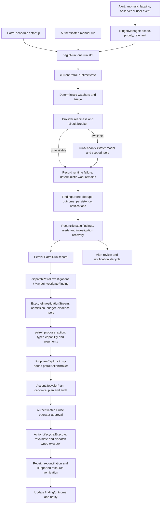

# Pulse / Sindri — Patrol, Entitlements, and AI Gateway Audit

**Audited:** 2026-10-27
**Repository:** `gonecrzy/Pulse`
**Branch:** `feature/komodo-phase2-foundation`
**Scope:** Read-only architecture and entitlement audit. No runtime code, tests, license checks, provider configuration, infrastructure actions, or deployment state were changed.

## Executive summary

Sindri should extend Pulse Patrol, not become a second scheduler, AI runtime, findings store, or remediation engine. Pulse already has scheduled and event-scoped Patrol runs, deterministic triage, provider/tool execution, persisted findings and history, investigation recovery, typed action proposals, operator approvals, action audit, and typed execution adapters. Phase 2G/2I also put canonical Komodo and topology evidence into the shared resource graph and AI query tools.

The useful gaps are narrower:

1. The fork feature profile exists, but `fork.ai_investigation` does not replace Pulse's commercial gates on general automatic Patrol investigations or alert analysis. Its current public path is explicit finding re-investigation. Keep that distinction and define the Sindri-owned paths at one fork capability boundary.
2. The OpenAI-compatible provider already accepts a custom base URL and can call Codex-LB's Chat Completions endpoint. Codex-LB-only provider enforcement is not implemented; `fork.codex_lb_gateway` is registered but unavailable. The provider's model listing expects `/models`, and model use needs an actual tool/stream preflight against the deployed Codex-LB version.
3. The Patrol workspace already owns findings, activity, readiness, objectives, investigation detail, and links to the canonical action inbox. Add topology context and repair/case views there. The standalone Assistant launcher/chat UI is retired; the shared backend chat service remains in use by investigations.
4. Pulse has durable single-action plans and action audit, but no operator-owned case aggregate spanning alert occurrences and investigations, nor an ordered multi-step repair-plan lifecycle. Those are the main workflow-model additions before multi-step repair.
5. Komodo is presently monitoring-only. `internal/komodo` allowlists version and inventory reads; it has no start, stop, restart, or redeploy mutation adapter. Future mutations must be new typed capabilities through Pulse's action lifecycle.
6. Discord supports outbound notifications. There is no Discord interaction receiver or Discord approval channel yet. Discord approval remains a future transport over the same authenticated action lifecycle.

Pulse already checks a config-backed `PatrolActionEmergencyStop` in canonical action admission. The fork's `fork.action_safety` is still unimplemented, and source inspection found no public settings/API control for that emergency-stop flag or a distinct durable “Disable Automation” control. Complete and expose these controls before enabling automatic progression; do not rebuild the existing stop check as a second kill switch.

Pulse license checks, fork availability, API/provider authentication and billing, model readiness, cost budgets, security authorization, and action safety are separate controls. Do not change Pulse tier maps, hosted entitlement validation, tenant checks, provider credentials, or approval/dispatch gates to make Sindri available.

## Audit boundaries and evidence

The audit inspected the runtime paths in `internal/ai`, `internal/api`, `internal/actionlifecycle`, `internal/actionplanner`, `internal/komodo`, `internal/forkfeatures`, `internal/license`, `internal/config`, `pkg/licensing`, and `frontend-modern/src`. It also reviewed the existing Sindri roadmap and Phase 2G/2I topology notes. Statements about Komodo live qualification refer only to the already recorded isolated qualification in the roadmap; this audit made no live provider call.

Codex-LB compatibility was compared with the v1.25.0-beta.9 [Chat Completions compatibility specification](https://github.com/Soju06/codex-lb/blob/69f128afcbc616d9f8e924ca6583f7031d75cf82/openspec/specs/chat-completions-compat/spec.md) and [client setup notes](https://github.com/Soju06/codex-lb/blob/69f128afcbc616d9f8e924ca6583f7031d75cf82/docs/client-setup.md). Those sources document the upstream project's contract; they do not certify a specific local Codex-LB deployment.

## A. Existing capabilities matrix

“Operational” means the path is present and can run under its configured license, feature profile, provider, authentication, and policy. It does not mean every path is enabled by default.

| Capability | Implemented | Operational | Reusable | Gaps |
|---|---|---|---|---|
| Scheduled Patrol | Yes: `PatrolService.Start` → `patrolLoop`; schedule deadlines persist and missed intervals are bounded. | Yes when Patrol is enabled and runtime state is available. | Yes; retain as the only recurring Patrol scheduler. | Accepted runs are process-local until completion; a crash can lose an in-progress run record. |
| Manual and scoped Patrol | Yes: `HandleForcePatrol`, `ForcePatrol`, `ForceScopedPatrol`, `runScopedPatrolWithStart`. Manual and resource-scoped runs share run admission and history. | Authenticated API path; readiness, mode and product checks still apply. | Yes. | Scoped work requires an unambiguous current canonical resource. |
| Event-driven Patrol | Yes: `TriggerManager` queues prioritized, rate-limited scopes; alert, anomaly, flapping, observer and user-action bridges exist. | Trigger configuration and product gates apply; queue and run slot are process-local. | Yes. | Queue loss on restart; the no-manager alert fallback is bounded and may drop work. |
| Deterministic monitoring and triage | Yes: watcher checks and `runDeterministicTriageState` run independently of successful model output. | Continues when the provider is down, subject to the ordinary monitoring inputs. | Yes; this is the resilience floor. | Some direct finding writers bypass the common notification/unified-sync path. |
| AI analysis and evidence tools | Yes: `runAIAnalysisState`, scoped tool manifests, `ToolRegistry`, provider adapters and query tools. | Requires enabled/configured provider, readiness, budgets and relevant entitlement/mode. | Yes. | Tool and model protocol success is provider/model dependent. |
| Findings, dedupe and persistence | Yes: `FindingsStore.Add`, `recordFindingWithInvestigation`, persistence adapters, outcome and occurrence checks. | Available to Patrol and investigation routes permitted by the current policy. | Yes; retain one findings store and lifecycle. | Reused stable IDs can absorb a distinct report; direct producers do not all share callbacks. |
| Investigation dispatch and recovery | Yes: `MaybeInvestigateFinding`, `setupInvestigationOrchestrator`, `ExecuteInvestigationStream`, stuck-session recovery and timed-out retries. | Explicit fork re-investigation is separately available behind `fork.ai_investigation`; general autonomy/alert analysis still has commercial `ai_autofix` / `ai_alerts` gates. | Yes; it is the Sindri diagnostic engine. | Align only Sindri-owned admission paths with fork policy; do not make commercial Pulse behavior free. |
| Typed repair proposals | Yes: `patrol_propose_action` → `ProposalCapture` → tenant-bound `patrolActionBroker` → `ActionLifecycle.PlanWithOptions`. The model can propose a catalog action, not send a command. | Governed actions and current action/policy gates apply. | Yes; use this action registry and lifecycle. | Proposal planning is not itself approval, execution, or proof of recovery. |
| Approval, execution, audit | Yes: `actionlifecycle.Service.Plan`, `Decide`, `Execute`, actor binding, org-scoped records, revision/hash checks, executor readiness and durable outcomes. | Authenticated operator and capability/action authorization are required. Autonomous policy progression is separately feature-gated and unavailable in the current fork profile. | Yes; canonical boundary for every future adapter and transport. | No generic multi-step plan orchestrator or universal rollback manager. |
| Typed execution adapters | Yes for selected Docker/container, Proxmox guest, host-update, host-storage-cleanup and TrueNAS app operations, wired through Pulse's routed action executor. | Only advertised capabilities with a matching executor and live readiness can execute. | Yes; add Komodo as typed adapters here. | Komodo mutation capabilities and their reconciliation/verification are absent. |
| Execution verification and recovery | Partly: plans include safety/verification descriptions; typed executors can emit operation receipts; action recovery reconciles persisted execution records. | Per adapter and receipt protocol. | Reuse executor receipts and lifecycle recovery. | A successful operation receipt is not a generic assertion that the service recovered. Add resource-state verification for each future Komodo action; do not imply rollback. |
| Alerts, notifications and incidents | Yes: canonical alert lifecycle/synthesis, recovery, notifications, Discord webhook output and incident projections. | Monitoring path is independent of AI. | Yes; Pulse remains incident authority. | Incidents are not a case/work aggregate with operator-managed alert membership and repair plan. |
| Historical investigations and operational memory | Yes: Patrol run-history store, investigation records, and `internal/ai/memory` incident memory. | Depends on persistence and relevant API policy. | Yes; extend existing records. | Separate stores do not yet form a unified operator case timeline. An accepted run that dies before completion has no completed history record. |
| Topology-aware evidence | Yes in canonical resource graph and `pulse_query` tools; Phase 2G/2I added bounded topology traversal, freshness and provenance. | Available to resource queries and model tool context. | Yes; same graph for UI and diagnosis. | No dedicated topology context panel integrated into the Patrol investigation screen. |
| Assistant handoff and UI | Backend handoff exists: `BuildPatrolRunAssistantHandoff` rehydrates bounded context from stored runs. | Backend only. The Assistant chat launcher/panel and run-history handoff affordance are absent in current frontend. | Keep the shared chat service used by investigations. | Do not add a second Sindri or Assistant nav; present diagnosis in `/patrol`. |
| Patrol workspace | Yes: `/patrol/*` is `AIIntelligencePage` → `PatrolIntelligenceSurface`; Inbox, Protection and Activity tabs, findings, readiness, history, objectives and action links are present. | Existing account/feature settings apply. | Yes; primary Sindri workspace. | Add topology-linked case and repair views; point to central AI settings for provider edits. |
| Codex-LB exclusive gateway | Custom OpenAI-compatible endpoint support exists. `FeatureCodexLBGateway` is registered but `Implemented` is false. | A custom endpoint can be configured, but a gateway-only policy cannot currently be enabled. | Extend existing provider path. | Central provider enforcement, preflight qualification and no-alternate-provider guarantee. |
| Komodo actions and Discord approvals | No Komodo mutation adapter; no Discord interaction receiver. | Not operational. | Use action lifecycle for mutations and existing notification transport for outbound messages. | Typed Komodo capabilities and authenticated Discord interaction/actor mapping are future work. |

### Runtime call graph

`PatrolActionBroker.Submit` contains a core-owned policy progression path, but the personal fork's `fork.action_safety` capability is currently unimplemented and cannot be enabled through the profile. Treat current Sindri action proposals as operator-reviewed plans. Do not infer automatic dispatch from the existence of an autopilot settings surface or a model proposal.

## Runtime detail and exact ownership

### Patrol and findings

- `internal/ai/patrol_run.go`: `PatrolService.Start`, `patrolLoop`, `runPatrolWithTriggerStart`, `runScopedPatrolWithStart`, `TriggerPatrolForAlert`, and run-slot admission. The full run gathers state, executes deterministic update/APT/guest and other configured watchers, optionally runs model analysis, then performs finding/alert cleanup, stuck-investigation recovery, timed-out retry, and run-history persistence.
- `internal/ai/patrol_triggers.go`: `TriggerManager` queues event scopes, deduplicates/limits them, and applies priority/backoff. `internal/api/router.go` connects alert and observer signals. Manual `/api/ai/patrol/run` is implemented by `AISettingsHandler.HandleForcePatrol` in `internal/api/ai_handlers.go`.
- `internal/ai/patrol_state.go` and `internal/ai/patrol_triage.go`: runtime input collection and deterministic assessment. `internal/ai/patrol_ai.go` owns model analysis/tool execution. Provider failure becomes a runtime finding; it does not turn off the deterministic collectors.
- `internal/ai/patrol_findings.go`: `recordFindingWithInvestigation`, `dispatchPatrolInvestigations`, and `MaybeInvestigateFinding`. `internal/ai/findings.go`: stable-ID dedupe, recurrence/disposition behavior, and occurrence-bound investigation outcomes. Persistence is in `internal/ai/findings_persistence.go` and `internal/ai/patrol_history_persistence.go`.
- There are producer-path exceptions: some watcher/PDM code calls `FindingsStore.Add` directly, so it can skip push notification or unified-resource mirroring. This is a focused integration gap; it does not justify a parallel findings database.
- Event queues, current run admission and completion-written history are process-local/at-run-boundary. On crash, queued triggers and accepted-but-incomplete run history may be lost. Durable findings and action state have separate recovery paths.

### Investigations and action lifecycle

- `internal/api/ai_handlers.go`: `setupInvestigationOrchestrator` and `orchestratorChatAdapter.ExecuteInvestigationStream` connect Patrol to `internal/ai/chat/service_investigation.go:ExecuteInvestigationStream`. The runner applies admission, investigation tool profile, provider/model choice, timeout/evidence limits, spend budget and captured outcome. `HandleForkReinvestigateFinding` is an explicit public fork route using the fork investigation feature.
- `internal/ai/tools/execution_profile.go`, `internal/agentcapabilities/patrol_scope_tools.go`, and `internal/ai/tools/tools_propose.go` constrain investigation tools. `patrol_propose_action` accepts a stable target ID, action catalog capability and schema-checked parameters; it does not expose arbitrary infrastructure command execution.
- `internal/api/patrol_action_broker.go` binds proposal to organization, finding, investigation and evidence. `Plan` persists a plan without approval or execution. The separate policy progression path calls the canonical service only when its server-owned policy factors allow it.
- `internal/actionplanner/planner.go`, `internal/actionlifecycle/service.go`, `internal/unifiedresources/actions.go`, and `internal/api/actions.go` own action intent, validation, plan hash/revisions, approval requirements, actor binding, approval record, dispatch, audit and recovery. HTTP actions routes apply authentication, scope and action authorization; the lifecycle/service checks admission availability and the relevant fork capability.
- Action plans are one typed action, not a general ordered repair workflow. `Preflight.VerificationSteps` is descriptive per-action guidance; executor receipts and lifecycle recovery are adapter-specific. A future multi-step case must persist each step, stop on failed/uncertain steps, and bind approvals to immutable target and plan identities.
- `PatrolActionEmergencyStop` is read by the router and enforced by the canonical action lifecycle against new approval/dispatch admission. It is stored in AI config, but no public settings or API mutation path was found in this audit. It does not cancel an already admitted external operation. The separate `fork.action_safety` feature remains unavailable.
- No general rollback contract exists. Compensation must be a new typed action under the same policy, never an automatic reverse command inferred from prose.

### Topology, incidents, and memory

- `internal/unifiedresources` owns canonical resource identities, provider observations, relationship graph and action capability projections. The completed Phase 2G/2I changes let bounded `pulse_query` traversal expose Komodo/Proxmox topology with edge provenance/freshness. `internal/ai/tools/tools_query.go` is the model read path.
- `internal/alerts/incident_synthesis.go` and alert lifecycle own alert correlation and recovery. `internal/unifiedresources/incidents.go` owns incident projections/queries; `internal/ai/memory/incidents.go` retains historical operational incident memory.
- `internal/ai/investigation_records.go` and Patrol findings/history retain investigation outcomes. No checked-in `internal/cases` aggregate provides operator-owned membership across alerts, findings, investigations and plans. Add a case aggregate only if the UI requires lifecycle, audit and membership that existing alert incidents cannot represent; keep it as a projection/references over canonical IDs, not a competing incident authority.

### Frontend and navigation

- `/patrol/*` routes to `frontend-modern/src/pages/AIIntelligence.tsx`, which renders `features/patrol/PatrolIntelligenceSurface.tsx`. The existing three views are Inbox, Protection and Activity. The surface already displays findings/attention, objectives, weekly digest, recent work, review/history and a route to `/actions`.
- `features/patrol/PatrolIntelligenceWorkspace.tsx`, `components/AI/FindingsPanel.tsx`, `components/patrol/RunHistoryPanel.tsx`, and action review surfaces contain reusable investigation and approval detail. `components/Alerts/InvestigateAlertButton.tsx` routes users into Patrol.
- The Assistant overlay/launcher has been removed from the current app and tests assert no Assistant chat window. Backend `/api/ai` chat services and the run-handoff builder remain; current Patrol history UI does not invoke the handoff. Preserve the service needed by investigations, but do not restore a separate chat navigation surface as part of Sindri.
- AI provider/model and key editing is already in Settings at `components/Settings/AISettings.tsx`. Keep credentials there; Patrol should show redacted endpoint/model/readiness and link to Settings rather than duplicate credential forms.

## B. Entitlement and external-service dependency matrix

| Restriction / exact source | Protected capability and class | Self-hosted / hosted; external call and outage behavior | Sindri support and change risk |
|---|---|---|---|
| `pkg/licensing/service.go`: `HasFeature`, `RequireFeature`, tier resolution; `pkg/licensing/features.go`: `TierFeatures` / `TierHasFeature`; `internal/license/features.go` shared definitions | Pulse commercial product features; **product subscription/entitlement**. Patrol base is Free/BYOK. Pro gates alert analysis (`ai_alerts`) and governed Patrol fixes (`ai_autofix`); tier maps also cover Relay, long-term metrics, Kubernetes AI compatibility, agent profiles, RBAC, audit, reporting and external probes, with higher tiers for multi-user, multi-tenant and white-label. | Self-hosted and hosted use locally resolved entitlements for normal checks; no network request per feature check. Hosted billing capabilities may come from tenant state. | Preserve. Changing tiers affects many APIs and surfaces and could turn Community into paid/private feature access. Sindri features must use `fork.*`, never rewrite commercial entitlements. |
| `internal/api/licensing_handlers.go`: `RequireLicenseFeature`, `LicenseGatedEmptyResponse`; feature routes in `router_routes_licensing.go`, `router_routes_ai_relay.go`, `router_routes_auth_security.go`, `router_routes_registration.go`. | Paid Relay, SSO, RBAC, audit, reporting, agent profiles, external probes, and related Pulse capabilities; **product entitlement**. | Both; ordinary checks read local license/subscription state. No per-route external request. Some list endpoints return an empty result with license headers instead of HTTP 402. | Preserve feature-specific gates and semantics. Removing one can expose a Pulse paid/private API or misrepresent the license. Sindri UI should use `fork.*` only for independently available fork behavior. |
| `internal/api/middleware_license.go`: `RequireMultiTenant`, `CheckMultiTenantLicense`; `internal/api/middleware_tenant.go`: `TenantMiddleware.Middleware`, `isHostedSubscriptionValid`. | Non-default tenant access; **product entitlement + security boundary**. | Self-host requires explicit multi-tenant setting and entitlement; hosted tenant access requires valid active/grace/trial state. Entitlement checks are local; membership authorization still checks the actor's access. | Preserve both licensing and tenant membership checks. Removing the first changes product scope; removing the second risks cross-tenant data exposure. Sindri should retain single-org default unless separately supported. |
| `pkg/licensing/service.go`: `ActivateWithKey`, grant status; `pkg/licensing/license_server_client.go`; `pkg/licensing/grant_refresh.go`; `pkg/licensing/installation_status_poll.go` | Self-hosted Pro grant activation, refresh/revocation and installation status; **product subscription**. | Self-hosted Pro contacts Pulse's licensing service for activation and periodic refresh/status (about six hours for grant refresh and about five minutes for status polling). Transient failures use backoff/cached grant; explicit suspension/revocation and expiry/grace rules alter paid access. Expired grants have a seven-day grace period. Community/BYOK AI need not use Pro features. | Preserve Pulse's license server protocol and behavior. An outage delays refresh; removing checks would undermine paid access, expiry and revocation. This service is not the AI request proxy. |
| `pkg/licensing/entitlement_payload.go`, `trial_activation.go`, `entitlement_lease.go`, and `database_source.go` | Trial eligibility, trial end date and expiry; **product entitlement**. | Hosted trials are represented by signed lease/subscription end dates and fail closed after expiry. The current self-hosted entitlement payload does not offer new trial eligibility; the legacy self-hosted trial-activation claim is retired. Paid self-hosted grant expiry follows the seven-day grace behavior above. | Preserve hosted trial signature/end-date checks and retired self-hosted behavior. Do not create a new trial entitlement as a side effect of the fork profile. |
| `internal/api/hosted_entitlement_refresh.go`; `pkg/licensing/entitlement_lease.go`; `pkg/licensing/database_source.go`; `internal/api/middleware_tenant.go` | Hosted/B2 signed entitlement lease, trial/expiry and hosted tenant routing; **hosted product entitlement + tenant boundary**. | Hosted only for lease refresh. It calls configured hosted refresh when needed; transient failures preserve a cached signed lease until expiry, invalid/expired/host-mismatched leases fail closed, and permanent rejection clears state. Normal entitlement reads are local. | Preserve signatures, organization/host binding and expiry. Relaxing them can mint or cross-assign entitlements or expose hosted tenants. Not a Sindri feature switch. |
| `internal/api/payments_webhook_handlers.go`: `HandleStripeWebhook`; `pkg/licensing/stripe_subscription.go`: subscription-state mapping | External payment status to hosted billing state; **hosted product entitlement input**. | Hosted/cloud provisioning only. Stripe webhooks are signature-checked and durably deduplicated before subscription state is applied; ordinary runtime feature checks use stored state rather than calling Stripe. A missed webhook can leave state stale until the payment event is reconciled. | Preserve signature verification, idempotency and fail-closed unknown statuses. This is payment-state ingestion, not an AI provider requirement or fork availability gate. |
| `internal/config/billing_state.go`; `internal/config/entitlement_billing_state.go`; `pkg/licensing/database_source.go` | Persisted billing/trial state and entitlement lease material; **entitlement input and integrity protection**. | Local reads/writes; used by self-hosted and hosted processes. HMAC/encrypted lease integrity is checked locally. Hosted refresh/billing flows contact their service separately. | Preserve integrity, encryption and organization isolation. Altering this can expose refresh credentials or treat tampered state as paid. |
| `internal/api/ai_handlers.go`: `HandleUpdateAISettings`, `GatePatrolAutonomyUpdate`, `HandleUpdatePatrolAutonomyMonitorOnly`; `internal/ai/service.go`: `GetEffectivePatrolAutonomyLevel`, `PatrolInvestigationLicensed`, `StartPatrol`, `IsAutonomous` | Patrol cadence and paid autonomous/investigation modes; **product entitlement**. Community cadence is clamped (currently one run/hour); `ai_autofix` gates broader autonomous investigation/fix paths. | Local check; no license server request per run. Some admin/status refresh is separate. | Fork explicit finding re-investigation is separately implemented via `fork.ai_investigation`; enabling it does not grant the commercial general automatic mode. Do not globally remove these checks or change plan mappings. |
| `internal/api/attention_actions.go`: `projectAttentionActions`, `handleAttentionActionPlan`; `internal/api/router.go` wires `SetActionLicenseChecker` | AI-assisted operational-trust action offer/plan (currently a narrow Docker restart action); `ai_autofix` **product entitlement** plus current plan/approve/execute authorizers and executor readiness. | Both; local entitlement and action checks. No license server call per offered or planned action. | Preserve both entitlement and security/action checks. Fork `fork.governed_actions` should not silently expose this separately paid Pulse attention workflow. |
| `internal/ai/service.go` and `internal/api/ai_handlers.go`: alert-trigger AI settings/runtime | AI analysis of fired alerts via `ai_alerts`; **product entitlement**. | Local check, both hosted and self-hosted. Provider requests occur only when analysis is enabled and permitted. | Preserve Pulse product gate. Naming in the catalog and runtime use has some legacy ambiguity; verify exact route before adjusting any UI. A fork-owned incident diagnosis path should have its own explicit capability. |
| `internal/forkfeatures/profile.go`: `Manager.Snapshot`, `Require`, `AccessResolver`; `internal/api/fork_features.go`: `withForkCapability`; fork feature routes | Personal-fork availability; **fork product policy, not a license**. Default allowlist is empty; only features marked implemented can become available. Presently `fork.ai_investigation` and `fork.governed_actions` are implemented. | Local profile, no external call. Corrupt/unavailable profile fails closed. `fork.ai_investigation` has a commercial `ai_autofix` resolver fallback for relevant Pulse paths; governed actions do not. | This is the right Sindri-owned feature mechanism. Keep public capability API separate from license claims. Current feature still does not replace all commercial Patrol runtime gates. |
| `internal/api/router_routes_ai_relay.go`, `router_routes_monitoring.go`, `internal/api/actions.go`, `internal/actionlifecycle/service.go` | Authentication, session scopes, per-org ownership, action capability, actor approval and dispatch authorization; **security authorization/action safety**. | Both deployments; local auth/session/org and policy state. External action executor calls are separate. Failure to resolve actors, scope, policy or durable action state denies/blocks the protected operation. | Never remove or weaken. This is independent of Pulse license and `fork.*`. Removing it risks unauthorized config, cross-tenant access or infrastructure mutation. The action lifecycle rechecks availability even when a specific route wrapper is not the enforcement point. |
| `internal/api/router.go`: `SetActionAdmissionAvailability`, `SetPolicyExecutionAvailability`, and `PatrolActionEmergencyStop` wiring; `internal/api/router_routes_monitoring.go`; `internal/forkfeatures/profile.go` | `fork.governed_actions` enables canonical action lifecycle; `fork.action_safety` separately gates autonomous policy progression and is not implemented; a config-backed emergency-stop check is already enforced; **fork availability + action safety**. | Both; local profile and action state, no external entitlement call. Current fork profile cannot enable automatic safety capability. The stop flag is stored in AI config, but no public mutation control was found. | Preserve separate gates. Manual operator approval/execution is not permission for automatic execution. Do not enable action safety by toggling governed actions; expose and audit the existing stop before automatic progression. |
| `internal/ai/service.go`: `CheckBudget`; `internal/ai/patrol_ai.go`; `internal/ai/chat/service_investigation.go`; `internal/ai/cost`, `internal/telemetry/patrol_cost.go` | Configurable spend limit, turn/evidence/timeout budgets, rate and concurrency caps; **usage/safety budget**. | Local accounting/admission plus provider rate responses. No Pulse entitlement request. Cost is estimated from known model pricing/token usage, not a billing settlement; unpriced gateway models may not accrue a reliable monetary estimate. | Keep independent from license and action authority. Preserve limits; explain that budget is a local guard, not a guarantee/cap on the external provider invoice. |
| `internal/ai/patrol_readiness.go`, `internal/ai/patrol_model_readiness.go`, `internal/ai/providers/*` | Credentials, endpoint reachability, model protocol/tool-calling and streaming; **provider authentication/billing and model readiness**. | Both; actual calls go to the selected provider/gateway. Codex-LB still needs its own gateway auth policy and upstream account/API source; remote account use may incur third-party cost. Failure blocks model work but deterministic monitoring continues. | Keep real connection and tool preflight. `fork.ai_investigation` cannot supply a provider credential or make an incapable model suitable. |
| `internal/api/ai_handlers.go`: provider settings handlers; `frontend-modern/src/stores/license.ts`, `licenseEntitlements.ts`, `forkCapabilities.ts`, Settings/AISettings | UI visibility, secret handling and fork capability presentation; **presentation/security support, not authorization**. | Both; local API. Product capability load failure falls back to Free presentation; fork capability load failure leaves fork features unavailable. API keys are masked/not returned as saved values. | Keep frontend claims aligned with backend, and never treat hidden/shown controls as an enforcement boundary. Store/edit secrets only through existing protected settings APIs. |
| `pkg/licensing/monitored_system_limit.go`: `NormalizeMonitoredSystemLimits`; `legacy_v5_monitored_system_limit_aliases.go` | Historical `max_monitored_systems` commercial cap metadata; **legacy/retired restriction**. | No active self-hosted core monitoring cap. Old limits are scrubbed from grants, leases and billing state. | Do not revive the retired volume gate while building Sindri. Preserve compatibility scrubbing so old state cannot accidentally restore it. |
| `internal/telemetry/telemetry.go`, `pulse_intelligence_evidence.go`, and `patrol_cost.go`; `internal/config/config.go`: `TelemetryEnabled`; Settings System/General | Content-free outbound usage telemetry; **telemetry, not entitlement or AI inference**. | Enabled by default. After a two-minute startup delay, a daily ping is sent to `https://license.pulserelay.pro/v1/telemetry/ping`; install ID rotates every 30 days. The payload includes coarse provider class, token buckets, Patrol/investigation/action outcome counters and other bounded usage buckets, but no provider/model/endpoint/account identifiers, prompts, messages, infrastructure IDs, secrets or IP field. Failure is logged and retried at a later heartbeat. | Independent from Codex-LB inference. For a deployment that should avoid this Pulse cloud call, turn off “Outbound usage telemetry” in Settings → System → General or set `PULSE_TELEMETRY=false`. Do not confuse this optional sender with required licensing validation for an activated paid grant. |

### Entitlement conclusions

- Pulse's product tier gates and self-hosted licensing are legitimate for Pulse-owned paid capabilities. They are local during ordinary feature checks, though paid activation and refresh contact Pulse licensing services. A self-hosted Codex-LB route removes a Pulse cloud AI proxy dependency; it does not remove independently configured Pulse Pro validation or the gateway/upstream provider's own account requirements. By default, separate daily content-free Pulse usage telemetry also leaves the host; operators can disable it through Settings or `PULSE_TELEMETRY=false`.
- Hosted tenant lease checks are a different system: signed, organization/host-bound, expiring, and fail-closed on invalid/expired state. They are not an optional fork feature switch.
- The fork profile is default-empty and fail-closed. It provides honest public availability only. The profile does not confer an executor, an approval, commercial status, or an upstream Komodo permission.
- The explicit finding investigation route is not equivalent to general event-driven Patrol automation. A future Sindri capability should authorize only the fork-owned route/service explicitly wired to it; paid Pulse behaviors must continue to pass their existing `ai_autofix` / `ai_alerts` checks.
- Action authorization and tenant boundaries remain mandatory even when a fork capability is on. `fork.governed_actions` allows use of the existing typed lifecycle; `fork.action_safety` is a distinct unavailable capability.

## C. AI provider and Codex-LB audit

### Current provider path

- `internal/config/ai_providers.go` registers several providers and protocols. OpenAI is explicitly described as supporting OpenAI or a custom OpenAI-compatible URL. `internal/config/ai.go` stores selected provider/model, custom `OpenAIBaseURL`, credentials, request timeout, budget and investigation limits.
- `internal/ai/providers/factory.go` builds the selected provider. `internal/ai/providers/openai.go:NewOpenAICompatibleClient` normalizes a supplied URL to `/chat/completions`; `ListModels` derives `/models` from that endpoint. The API supports listing/caching models and settings accepts a configured model ID. Test connection/model discovery and model-use preflight are different checks.
- Provider keys are edited by the authenticated/admin AI settings API and are not returned as their saved values. Do not copy provider credentials into Patrol records, reports, URLs or telemetry.
- The OpenAI-compatible adapter supports tool/function calls and SSE streaming. It has bounded request/stream timeouts, transient retry/backoff on supported paths, and provider error normalization. Patrol also has its own circuit breaker; it records provider-blocked findings and keeps deterministic checks active.
- `internal/ai/patrol_model_readiness.go:RunPatrolModelReadiness` is the meaningful qualification path: it exercises multi-scenario context and tool-call protocol against the selected model and records latency/readiness dimensions. `RunPatrolToolPreflight` is a narrower tool-call check. Keep these checks; `/models` success alone proves neither tool calling nor streaming fidelity.
- Context limits and output budgets are estimated in the provider/chat layer; investigation turn/evidence/time limits and the local 30-day AI budget are separate. Cost estimates are not provider invoice reconciliation. A gateway must expose compatible usage fields for accurate token/cost accounting.
- The CLI subscription agents (`internal/ai/providers/subscription_agent.go`) are a separate provider kind. The selected custom OpenAI-compatible endpoint does not itself require a Pulse cloud AI service, but a gateway-only policy would have to prevent any alternate provider path from being selected for Sindri work.

### Codex-LB assessment

**Base compatibility: plausible and directly supported by the existing transport. Exclusive enforcement: not implemented.** Pulse will send OpenAI Chat Completions requests to a custom base URL and can therefore point the existing OpenAI provider at Codex-LB's OpenAI-compatible endpoint. The Codex-LB current spec describes `/v1/chat/completions`, mapping to Responses semantics, streaming `chat.completion.chunk` events, tool-call deltas, non-streaming tool calls, and OpenAI-style errors. Its client setup also documents `/v1` for generic OpenAI-compatible clients.

There are important qualifications:

1. The Codex-LB client guide recommends its Responses API for clients that need to preserve encrypted reasoning content and multi-turn reasoning state; its guide warns that plain Chat Completions clients drop that state. Pulse's current provider adapter is Chat Completions, not Codex-LB Responses. The investigation loop can continue through ordinary tool calls/messages, but do not claim native preservation of Codex Responses state.
2. Pulse's custom OpenAI client discovers models with `GET /models` derived from the Chat Completions base URL. Codex-LB documents `GET /v1/models`, so this is expected to line up at `/v1`; still qualify against the pinned/local release. If discovery is unavailable or filtered, the selected explicit model ID and actual preflight matter more than a stale static list.
3. Codex-LB can authenticate the Pulse-to-gateway hop with its own API key when enabled. The gateway still needs its configured upstream sources/account. A local Codex subscription may avoid a separate model API invoice under that upstream provider's terms, but the Codex-LB endpoint is not itself an entitlement bypass or a guarantee of zero cost.
4. `FeatureCodexLBGateway` in `internal/forkfeatures/profile.go` is currently unimplemented. The current settings allow other provider IDs/credentials and subscription-agent paths. Thus the repo cannot yet promise Codex-LB is the only permitted AI route or reject alternate provider settings centrally.
5. Do not silently fall back to a direct provider if Codex-LB is unavailable. For Sindri diagnosis, the desired behavior is “AI unavailable, deterministic monitoring continues”; provider failure must be visible and must not switch data-egress routes.

**Recommended gateway design:** keep one existing OpenAI-compatible adapter; implement the fork feature at centralized AI provider admission/factory/service selection, not only in the UI. When enabled, validate the configured provider ID, normalized base URL/allowed scheme and selected model for Patrol, investigation and any retained chat call sites; disallow alternate providers/subscription agents for those call sites; fail closed when the policy or gateway is unavailable; and never auto-fallback. Reuse secret handling and preflight. Add a versioned capability status that says configured/connection-ready/tool-ready without returning credentials. Retain AI settings as the only place that edits the endpoint/key.

## D. Proposed Sindri-on-Patrol architecture and UI

| Component | Decision | Work |
|---|---|---|
| Pulse resource registry, alert/incident lifecycle, notifications, history and memory | Retain | Remain canonical for observations, identities, evidence provenance, alert state and recovery. |
| Patrol scheduler, trigger manager, deterministic triage, provider tools, findings store and run history | Retain | Continue to operate without any AI gateway. Bind Sindri investigations to existing schedule/events and resource-scoped context. |
| Investigation runner and model tools | Extend | Route Sindri-owned invocations through the fork feature resolver while preserving existing commercial gates for Pulse Pro autonomy/alert features. Reuse bounded evidence tools and typed proposal capture. |
| Existing action catalog, planner, lifecycle, approval, audit, typed executor and recovery | Retain | Every repair proposal, future Komodo adapter, UI approval and Discord interaction enters the same organization-bound APIs/service. Preserve the canonical config-backed emergency-stop check; expose it safely and add a distinct Disable Automation control before automatic progression. |
| Canonical topology and `pulse_query` | Retain and extend | Pass scoped graph neighborhoods, source/freshness and related alerts as structured evidence into investigation context; use the same graph in the UI. Phase 2G/2I provides the data foundation. |
| Operator case and ordered repair plan | Add only for actual workflow gap | Add references to alerts/findings/investigations and action IDs; immutable versioned plan/step states; stop-on-failure and uncertain-state behavior. Do not replace alert lifecycle or action audit. |
| Komodo mutations | Add as typed action adapters later | Define stable provider/resource/action capability, schema, readiness, approval level, executor and receipt/recovery behavior. Never pass arbitrary Komodo methods or AI-authored commands. |
| Discord | Defer as transport | Outbound notifications already exist. Add inbound authenticated interactions only after the approval/case contract exists; resolve Discord user to current Pulse actor/role and submit to canonical approval API. |
| Assistant chat launcher and standalone navigation | Keep retired | The backend chat runner remains shared infrastructure. Expose investigation explanations and follow-up actions in Patrol instead of restoring a duplicate Assistant/Sindri surface. |

### Unified operating interface

Use `/patrol/*` as the Sindri operations workspace and retain the existing Inbox, Protection and Activity route contract.

- **Overview/readiness:** extend the existing header and setup/readiness content with deterministic collection health, provider/gateway status, model capability status, last successful AI analysis, and an explicit “monitoring continues without AI” state. Show only a redacted gateway host/model label; use a link to Settings for credential or provider edits.
- **Active investigations/findings:** retain Inbox, FindingsPanel details, investigation timeline/messages, source evidence and outcome controls. Group into cases only when multi-alert membership or operator workflow needs a durable aggregate.
- **Topology context:** add an expandable canonical neighborhood on a finding/investigation, using IDs and provenance from the current resource graph. Label direct observation, inferred relationship, stale evidence, and unknown separately. Keep traversal bounded and avoid duplicating the resource browser.
- **Proposed repairs and approvals:** show the typed action plan and its target/capability/arguments/readiness as a proposal; approvals and execution remain on the current `/actions` experience. Preserve the exact plan/hash and the authenticated actor record.
- **Execution and verification history:** project action lifecycle events and operation receipts into Patrol's Activity/case timeline, while the action audit remains the source of truth. Display “command completed” separately from “service recovery verified.”
- **Automation policy:** use the current Protection/objectives settings for monitoring coverage and objective status. Put action automation policy controls behind a separate implemented fork safety capability; do not present current objectives or acknowledgement persistence as proof that automatic repair is enabled.
- **AI gateway/model configuration:** keep editing in Settings. Patrol may show model readiness, last check and a secure deep link, but must not create a second provider/key form.

## E. Ordered implementation plan

The branch has already completed the shared topology and Komodo monitoring foundation described in roadmap Phases 2E/2G/2I. The next work should use the following dependency order; this supersedes earlier roadmap rows that planned those foundations from scratch.

| Checkpoint | Scope | Completion evidence before next checkpoint |
|---|---|---|
| 1. Patrol/Sindri access and gateway foundation | Decide which new Sindri workflows are public fork features. Wire `fork.ai_investigation` to only those entry points; retain `ai_autofix` / `ai_alerts` checks on Pulse-owned features. Implement Codex-LB-only provider admission around the existing OpenAI-compatible client, keep secrets in Settings, and preserve fail-closed readiness/no-fallback behavior. Do not alter third-party licensing. | API/service tests show denied/unimplemented features fail closed; paid feature decisions remain unchanged; only the configured Codex-LB URL receives Sindri model traffic; tool/stream/model readiness failure is visible and deterministic monitoring still runs. |
| 2. Unified investigation and findings interface | Extend the current `/patrol` Inbox/Activity to show active investigations, finding evidence, proposal status and gateway readiness. Add no new Assistant or Sindri route. Keep `/actions` as the canonical approval/execution UI and link to it with the exact action ID. | Frontend/API tests confirm route and API compatibility, shared finding/action data, scoped permissions, secret redaction, accessibility and no duplicate navigation. |
| 3. Topology-aware diagnostic context | Use Phase 2G/2I's canonical graph in investigation scope: bounded neighbors, related active alerts, provider provenance, freshness, disagreement and confidence. Render the same IDs/evidence on the Patrol finding. | Synthetic fixture evidence proves bounded context, correct cross-provider identity, no name-only merge, no stale-edge causal suppression, and AI outage has no effect on monitoring. |
| 4. Explainable repair proposals and operator approval | Reuse `patrol_propose_action`, action catalog, planner/lifecycle and approval UI. Tighten finding/case linkage and display immutable target/action arguments, policy/readiness and required verification. Add a durable case aggregate and multi-step plan only where multi-alert/multi-step requirements exceed existing alert/action records. | Tests prove proposals cannot dispatch, approval binds exact plan/resource/policy revision and authenticated actor, stale changes require a new approval, cross-org IDs are denied, and multi-step plans stop on failure/uncertainty. |
| 5. Komodo typed action adapters | Add start/stop/restart/redeploy as explicit capability IDs and schemas through Pulse action catalog/target checks/executor. Keep read-only Komodo collector separate. Begin with exact resources/allowlist and least-privilege credentials; never permit arbitrary `/execute` or `write` passthrough from model input. | Adapter contract tests cover resource identity, provider permission, unavailable/stale target, argument schema, executor readiness, no credential leakage, approval levels, denied paths and organization isolation. Live mutation qualification is a later separately authorized activity. |
| 6. Execution verification and recovery | For each Komodo operation, persist dispatch attempt and idempotency identity, consume operation receipt, poll/reconcile authoritative Komodo state, classify verified/rejected/failed/unknown, and recover on restart without blind retry. Expose evidence and partial completion in the case timeline. | Fault-injection tests cover timeout before/after send, receipt loss, server restart, stale state, duplicate request, operation mismatch, recovery delay and unresolved unknown outcome. No inferred rollback. |
| 7. Controlled automatic repair policies | Implement `fork.action_safety` only after case/plan, exact allowlist, approvals, durable budgets/cooldowns/concurrency and actor/policy revision binding are in canonical action admission. Surface and audit the existing config-backed Emergency Stop, add a separate durable Disable Automation control, and define stop-on-failure and verified outcomes. | Durable state/restart/concurrency tests show safe default-off, stop precedence, no queue auto-resume, no dispatch on corrupted/unavailable policy state, and all automatic origins pass the same lifecycle. Manual actions retain normal authorization/approval. |
| Later. Discord operator channel | Add authenticated bot/gateway interaction verification, actor/role mapping, replay protection, expiry, idempotency and durable delivery/interaction records. Route review/approval to the existing action lifecycle; do not make Discord a dispatch authority. | Integration tests prove current Pulse role checks and both safety controls at decision and execution, plus duplicate/replayed/expired requests never produce a second decision or dispatch. |

Every checkpoint is independently reviewable. The action-adapter and automatic-repair checkpoints need separate safety review and do not authorize production actions, deployment, or merge to `sindri`.

## F. Risks and compatibility

### Database and configuration migration

- AI settings, fork profile, findings, run history, objectives and provider credentials use distinct persisted configuration/store paths. Action lifecycle and unified resources have their own durable organization-bound records. Do not fold these into a single new “Sindri database.”
- Adding provider-only configuration or new case/plan state needs explicit schema/version handling, defaults, validation, atomic/backup-safe writes, and downgrade behavior. Keep `DefaultProfile` empty and treat corrupt or unknown feature state as unavailable. Never rewrite Pulse commercial license or billing stores.
- Keep saved API-key reads masked, preserve current clear/replace semantics, do not put endpoint query credentials into URLs, and redact host tokens from logs/telemetry. Validate custom gateway URLs with the existing URL and restricted outbound-client rules.
- Adding case/plan projections should reference canonical `orgID` + resource/alert/finding/action IDs and preserve per-tenant storage. Do not migrate old alert identities by display name. Action `planHash`, resource revision and approval binding must remain intact.
- Any multi-step plan needs its own versioned immutable identity and append-only state history; existing single-action persistence cannot be silently reinterpreted as a multi-step plan.

### Frontend and API compatibility

- Preserve `/patrol/*`, `/api/ai/patrol/*`, finding routes and `/api/actions/*`; bookmarked Patrol paths and current consumers rely on these contracts. Add optional response fields rather than renaming existing payloads.
- Keep action approval and audit in the existing action surfaces. Patrol should link to the canonical action record and reflect its current state; it must not create a second approval dialog with separate state.
- Assistant's frontend chat surface is intentionally absent while backend services are reused by investigations. A new chat surface would duplicate state/navigation and create another access-control path.
- The `/models` discovery route and Chat Completions streaming/tool-call behavior must be qualified against the selected Codex-LB release. Do not assume all models behind the gateway share context limits, structured output, or tool calling.

### Licensing, security, and action regressions

- Keep commercial product gates, hosted lease validation, activation/refresh, tenant middleware, user/session/scope checks, fork profile checks, provider authentication, usage budgets, model readiness and action controls as separate layers.
- Enabling a `fork.*` capability must not change `pkg/licensing` feature payloads or frontend paid-entitlement stores. It must not imply Pro, alter self-hosted trial behavior or unlock commercial/private behavior.
- A custom endpoint can represent a remote provider. Gateway-only enforcement should prevent fallback and show when AI is unavailable; never hide outbound provider changes from the operator.
- No model output, event handler, Discord interaction or Komodo API result can become direct command execution. Every mutation must have an exact typed target/capability, authenticated actor, policy check, approval and durable audit.
- An in-flight remote action may complete after Pulse loses connection. Unknown outcomes retain their reservation/cooldown and require reconciliation; do not blind-retry or claim success/recovery from an HTTP 200 alone.
- Outbound Discord webhooks are not proof of authenticated Discord users. Any future inbound Discord command requires platform signature/gateway authentication and actor-role revalidation at both approval and execution.

## Audit outcome

This checkpoint changes documentation only. No audit-specific test was necessary because no executable contract changed; no test suite was run. The existing roadmap receives an as-of-date status correction and points here for the full audit and next implementation order.

## Phase 2K implementation overlay (2026-10-27)

The audit above records the Phase 2J source baseline. Phase 2K then added the
version-2 standalone fork profile, local admission for explicitly implemented
public standalone surfaces, and default-off Pulse commercial/telemetry egress.
The current profile's default allowlist and the five public Pro-gated surfaces
that require explicit administrator enablement are listed in the
[Phase 2K roadmap update](2026-10-23-sindri-integration-roadmap.md#phase-2k--standalone-fork-policy-and-upstream-service-removal).
Detailed destination and trigger classifications are in the
[standalone egress inventory](2026-10-27-standalone-egress-inventory.md).

Commercial entitlement JSON remains independently sourced from the existing
licensing service and does not report local capabilities as Pro features.
Standalone activation, refresh, installation-status polling, checkout, and
telemetry senders are disabled by default; old billing/license files are kept
for migration. The explicit compatibility environment switch is documented in
the roadmap and configuration guide. Hosted entitlement paths and security
authorization remain separate. Codex-LB-only enforcement, multi-step cases,
automatic repair safety, and action mutations are not part of this overlay.
